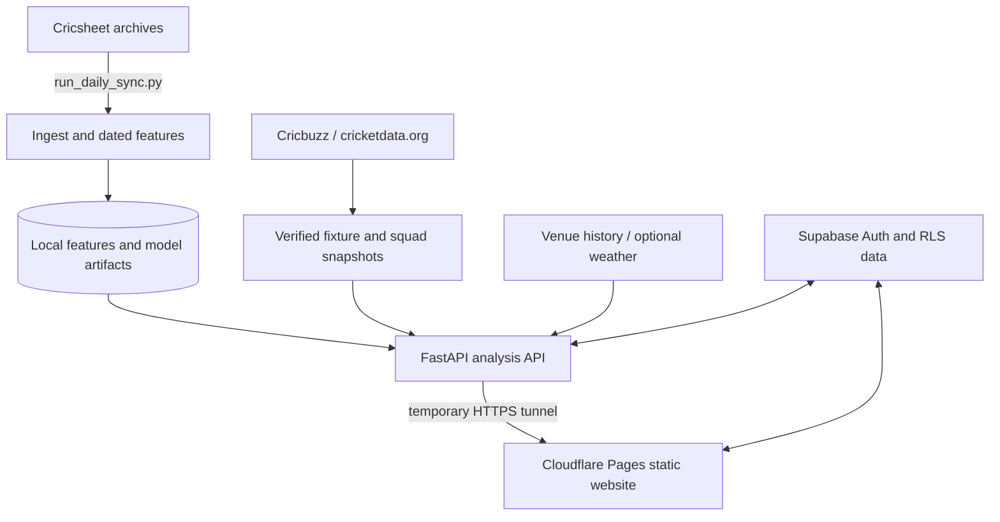

# NEW_X1 — Cricket Performance Intelligence Platform

> Predicts individual player performance and optimizes playing XI for upcoming cricket matches (T20, ODI, Test)  
> Expert analyst tool — not a fantasy sports app.

**Status:** The current checkout is `pitch-control-report`, and a read-only remote check found its committed HEAD also at `origin/main`. Uncommitted edits in this checkout have not been published. The public website is static, and the laptop API is available only while the operator runs it. Read the [current audit](docs/audit/README.md) before deciding on a release.

---

## Current deployment

The static website is published at [new-x1.pages.dev](https://new-x1.pages.dev/). GitHub Actions is configured to deploy relevant `main` pushes to this Cloudflare Pages project; this audit did not verify a new live deployment. The Python API and ML models run on a laptop; the website can reach them only while the API and an HTTPS tunnel are running. The site checks `/health` and shows an availability notice when analysis is unreachable or no models are loaded. Account sign-in uses Supabase separately from the laptop API.

From the source checkout, start the API, all three ML formats, and a temporary HTTPS tunnel with one command:

```powershell
.\run_all.bat
```

The launcher finds the sibling artifact checkout automatically on this laptop. Elsewhere, run `python run_all.py --artifacts-root '<absolute path to the checkout with env, data, and models>'`. It checks `/health`, tries Cloudflare Tunnel over HTTP/2, falls back to localhost.run, and keeps the API local while retrying if both are unavailable. Keep the terminal open. It prints **PUBLIC API** only after the public `/health` check confirms all three models; copy that HTTPS origin into [website Settings](https://new-x1.pages.dev/settings) and select **Save and test connection**. The temporary address is saved in each browser separately and changes after a tunnel restart. `run_all.bat --local-only` verifies the models without a public tunnel. See the [runbook](docs/RUNBOOK.md) and [Cloudflare guide](docs/CLOUDFLARE_DEMO.md) for recovery and data refresh.

The [Pitch Control report](docs/PITCH_CONTROL_REPORT_PLAN.md) is committed on `pitch-control-report` and the same commit is on remote `main`: qualifying venues show dated last-five/last-ten historical evidence; unsupported venues fall back to curated T20 priors or neutral values. This audit has not established that the current uncommitted changes are deployed. Historical reports do not change prediction multipliers until their benefit is backtested. See the [release-readiness audit](docs/audit/README.md).

Upcoming fixtures use provider squads when both teams are available. For later fixtures in the same series, saved provider rosters from earlier match IDs can be combined when the series, team names, and format match; the site labels these **Series squads** and warns that the playing XI is unconfirmed. If provider rosters are unavailable, a complete XI from each team's last completed same-format, same-gender match can supply a clearly labeled **Last-match estimate**. This fallback checks both fantasy history and dated domestic scorecard history, and reports the source dates. Fixtures without a complete two-team pool remain pending; the Custom Simulator is a separate option.

To request that the laptop analysis service be started, [email riddhu.work@gmail.com](mailto:riddhu.work@gmail.com?subject=NEW_X1%20backend%20request) or [message +91 8982094147](https://wa.me/918982094147). The [documentation index](docs/README.md) separates current operating guides from historical audits and hosting proposals.

## Local development and model training

### 1. Prerequisites
- **Python 3.10 or 3.11**
- **Node.js 22 and npm** (for the Next.js frontend)
- [Ollama](https://ollama.com) only if local AI commentary is needed

### 2. Environment Setup

**Python Backend Setup:**
```bash
python -m venv env
env\Scripts\activate          # Windows
pip install -r requirements.txt

# Pull local LLM for AI generation
ollama pull llama3.2:3b
```

**Next.js Frontend Setup:**
```bash
cd frontend
npm ci
cd ..
```

### 3. Generate Data (One-Time / Nightly Sync)
To dynamically pull the latest matches from Cricsheet (up to today) and run feature engineering:
```bash
python run_daily_sync.py
```
*Note: This downloads the T20, ODI and Test Cricsheet JSON archives, updates player fantasy points and Parquet features, and builds the versioned venue-history snapshot. Full future fixture and squad coverage depends on provider credentials; the API may continue using verified last-good feeds when a refresh fails.*

### 4. Train Models
```bash
python model/train_model.py
# Creates: model_artifacts/ProductUI_Model  (T20 CatBoost)
#          model_artifacts/tribe_odi.pkl
#          model_artifacts/tribe_test.pkl
```

### 5. Run analysis

Use `run_all.bat` above for the published website. FastAPI loads the T20, ODI, and Test models in one inference process; it does not retrain them on each launch. The local Next.js dev server and Streamlit evaluation UI are optional development tools; they are not required for `new-x1.pages.dev`. Press Ctrl+C (then Y if Windows asks to terminate the batch job) to stop the API and tunnel.

---

## 🏗️ Architecture



## 🔌 Port Map

| Service | Technology | Port | Purpose |
|---|---|---|---|
| **Product UI** | Next.js / React on Cloudflare Pages | HTTPS | End-user simulator and upcoming fixtures. Port `3000` is for optional local development. |
| **Main API** | FastAPI / Python | `8000` | ML Predictions, Optimization Solver, LLM calls. |
| **Model UI** | Streamlit | `8502` | Internal MAE benchmark evaluation dashboard. |
| **Ollama** | Local LLM Engine | `11434` | RAG/Context-aware explanations. |

---

## 🧠 Intelligence Engine

| Format | Core Model | Artifact Path |
|---|---|---|
| **T20** | CatBoostRegressor | `model_artifacts/ProductUI_Model` |
| **ODI** | TriBE Ensemble | `model_artifacts/tribe_odi.pkl` |
| **Test** | TriBE Ensemble | `model_artifacts/tribe_test.pkl` |

**TriBE architecture:** CatBoost, XGBoost and LightGBM outputs feed a linear meta-model trained from out-of-fold predictions. Saved evaluation results describe held-out data, not guaranteed future accuracy.

---

## 📊 Data Pipeline

- **Source**: [cricsheet.org](https://cricsheet.org) — ball-by-ball JSON
- **Training cutoff:** `2025-06-30` (`model/data_contract.py`); earlier archive coverage depends on available Cricsheet records.
- **Evaluation:** records after the cutoff are held out by the training/evaluation contract.
- **Upcoming fixtures:** only future, unended records from a validated provider snapshot are served; coverage depends on provider availability.

## 🔌 API Reference (FastAPI, port 8000)

| Endpoint | Method | Purpose |
|---|---|---|
| `/health` | GET | Model availability, active sources, fixture/squad freshness, and Ollama reachability. |
| `/matches` | GET | Upcoming fixtures feed. |
| `/match_squads?match_id=` | GET | Normalized, name-resolved squads with roles & injury status. |
| `/teams` | GET | Known team names + venues (Custom Simulator datalists). |
| `/generate_best_team` | POST | Full pipeline: squad → name resolution → T20 CatBoost or ODI/Test TriBE predictions → pitch/weather/injury adjustments → PuLP optimal XI. Accepts `match_id` or `team1+team2+format+venue+date`; returns constraint validation and data provenance. |
| `/explain_team` | POST | SHAP top-3 drivers per selected player + local-LLM analyst report (heuristic fallback when Ollama is offline). Body: `{"explain_token": "..."}` from the generation response. |

Optional generation flags: `use_ml` (saved model vs recent-form statistics), `use_intelligence` (weather/pitch/injury layer), `risk_aversion` (λ in `Σμ − λ·σ²`, 0.0–0.2), `scan_news` (Google News RSS injury scan, slow), and `allow_relaxation` (explicitly permits a weaker team/role mix). See [API reference](docs/API_REFERENCE.md).

## 🧩 Product Modules

- **Name resolver** (`model/name_resolver.py`): bridges Cricbuzz display names and Cricsheet keys. Gender-filtered, ambiguity is refused rather than guessed — a wrong match silently corrupts predictions.
- **Team generator** (`model/team_generator.py`): orchestrates prediction, league priors for players without history, PAF pitch multipliers, injury multipliers, PSD covariance, and the PuLP solver. Strict constraints are the default; relaxation requires an explicit request flag and is independently validated.
- **Intelligence layer** (`intelligence/`): Open-Meteo weather with venue geocoding + 30-min cache, dated Cricsheet-derived venue-history reports with validated fallback to curated pitch profiles or neutral adjustments, injury status engine, SHAP driver extraction, Ollama analyst. Historical reports are descriptive and leave fantasy-point multipliers neutral pending backtests. See [Pitch Control report](docs/PITCH_CONTROL_REPORT_PLAN.md).

## ⚖️ Hard Rules

1. Training data strictly `≤ 2025-06-30` (No future data leakage).
2. `model_artifacts/ProductUI_Model` must exactly match this path and have no file extension.
3. Measure UI/API latency in the target environment; the first call per format can be slower while models and datasets load.
4. Evaluation claims require the same saved artifacts, inputs, scoring rules, and cutoff; the internal Streamlit UI is not a production accuracy guarantee.
5. Fixture/squad feeds: the full 7-day window needs `RAPID_API_KEY` (Cricbuzz via RapidAPI) in `.env` — run `data/future_matches/schedule_fetcher.py` + `squad_fetcher.py`. Without it, `run_daily_sync.py` refreshes *imminent* fixtures via the free cricketdata.org key (`cricapi_sync.py`). On failure, the UI uses a validated local snapshot of still-future matches with a warning; it never treats expired fixtures as upcoming.

## Repository and configuration

```text
NEW_X1_cloudflare/
├── frontend/             Next.js static website
├── model/                API, training, inference, optimization, accounts
├── intelligence/         venue, weather, injury, explanation layers
├── data/                 fixture snapshots and generated-data locations
├── data_processing/      active Cricsheet/feature pipeline
├── pipeline/             optional versioned release worker/serving path
├── supabase/             account migration
├── tests/                Python contract and recovery suite
├── scripts/              operator and audit helpers
├── docs/                 guides, audit evidence and dated archive
├── run_all.py            laptop API/tunnel launcher
└── run_daily_sync.py     explicit data refresh orchestration
```

| Source | Responsibility |
|---|---|
| [model](model/README.md), [intelligence](intelligence/README.md) | Prediction/API/account state and venue/weather/explanation logic |
| [data processing](data_processing/README.md), [future matches](data/future_matches/README.md) | Historical pipeline and live provider snapshots |
| [frontend](frontend/README.md), [Supabase](supabase/README.md) | Static site and account database |
| [pipeline](pipeline/README.md), [scripts](scripts/README.md) | Optional isolated release path and operator helpers |
| [tests](tests/README.md), [docs](docs/README.md) | Verification and operating guidance |
| [legacy preprocessing](data_preprocessing/README.md), [Streamlit UI](UI/README.md) | Manual/reference tools |

Python 3.10/3.11 and Node.js 22 are the documented development runtimes; run `npm ci` from `frontend` against its committed lockfile. The saved model artifacts and large processed/raw data may be held in a separate checkout. Copy [`.env.example`](.env.example) to an ignored `.env` and [`frontend/.env.example`](frontend/.env.example) to `frontend/.env.local`. `RAPID_API_KEY` and `CRICKET_DATA_API_KEY` are optional for refreshing their respective feeds; `SUPABASE_URL`/`SUPABASE_PUBLISHABLE_KEY` and the frontend `NEXT_PUBLIC_SUPABASE_*` pair are required for deployed account access. `CORS_ORIGINS` should contain only the exact allowed website origins. `NEXT_PUBLIC_API_BASE` is optional with a temporary tunnel. Never put a service-role key in `NEXT_PUBLIC_*` variables.

## API and usage

`GET /live` checks process liveness; `/health` reports model/feed state; `/ready` additionally requires a recent verified release in the optional release-worker path. `/matches`, `/match_squads`, `/teams` and `/venues` supply catalogue data. `/auth/config`, `/me`, and `/analyses` support account state. `POST /generate_best_team` accepts a fixture ID or custom teams, date, venue and format; `POST /explain_team` accepts its one-hour explanation token. Generation, explanation and account routes require a verified user when Supabase is configured. The [API reference](docs/API_REFERENCE.md) describes inputs, outputs, authorization and errors; `/docs` exposes the runtime OpenAPI schema. Open the website's **Fixtures**, **Simulator**, **Account** and **Settings** pages for the corresponding flows.

## Verification and limits

From the root, run `.\env\Scripts\python.exe -m pip check` and `.\env\Scripts\python.exe -m unittest discover -s tests -p 'test_*.py' -v`. From `frontend`, run `npm run lint`, `npm run build:static` and `npm audit --omit=dev`. The [verification report](docs/audit/VERIFICATION.md) records actual audit results and limitations. A stale `/health` warning calls for a feed refresh; it does not mean model inference is unavailable. A `pending` squad means neither a complete provider/series roster nor a complete dated historical pair was found. The [runbook](docs/RUNBOOK.md) covers recovery. Load only trusted local joblib/pickle model artifacts. The temporary tunnel is not an always-on hosting service, and Supabase/RLS behavior needs live integration validation before a broad release.

For contributions, add a focused regression test for behavioral fixes, run the Python suite and frontend lint/static build, and update the relevant guide. See the [issue register](docs/audit/ISSUES.md). No repository license is declared; check the terms of external data and assets before redistribution.
