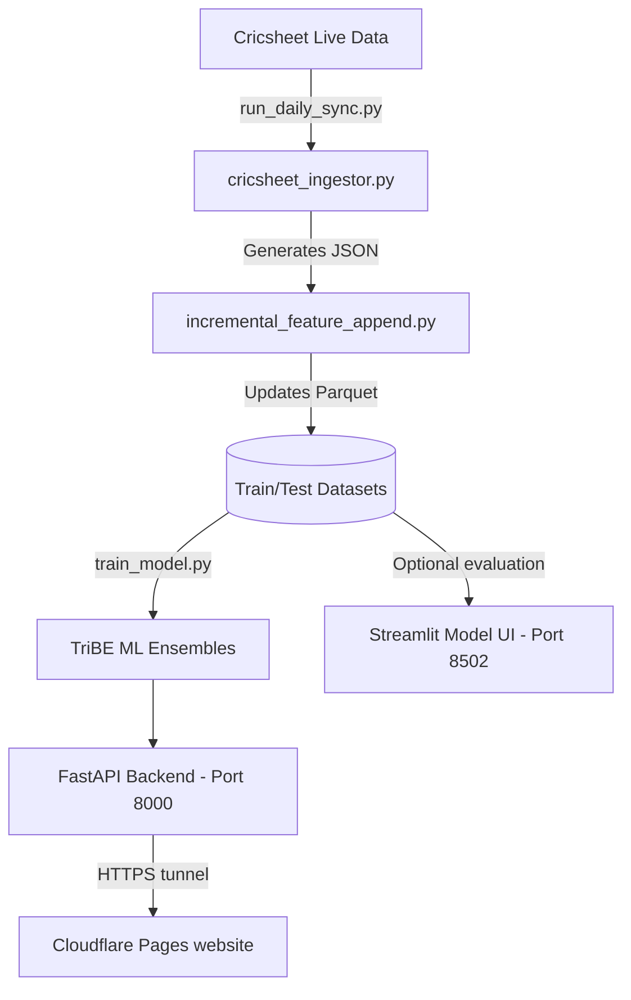

# NEW_X1 — Cricket Performance Intelligence Platform

> Predicts individual player performance and optimizes playing XI for upcoming cricket matches (T20, ODI, Test)  
> Expert analyst tool — not a fantasy sports app.

---

## Current deployment

The static website is published at [new-x1.pages.dev](https://new-x1.pages.dev/). GitHub Actions deploys pushes to `main` to this Cloudflare Pages project. The Python API and ML models run on a laptop; the website can reach them only while the API and an HTTPS tunnel are running. The site checks `/health` and shows an availability notice when analysis is unreachable or no models are loaded. Account sign-in uses Supabase separately from the laptop API.

From the production checkout, start the API, all three ML formats, and a temporary HTTPS tunnel with one command:

```powershell
.\run_all.bat
```

The launcher finds the sibling artifact checkout automatically on this laptop. Elsewhere, run `python run_all.py --artifacts-root '<absolute path to the checkout with env, data, and models>'`. It checks `/health`, tries Cloudflare Tunnel, falls back to localhost.run, and keeps the API local while retrying if both are unavailable. Keep the terminal open. When it prints **PUBLIC API**, copy that HTTPS origin into [website Settings](https://new-x1.pages.dev/settings) and select **Save and test connection**. The temporary address is saved in each browser separately and changes after a tunnel restart. `run_all.bat --local-only` verifies the models without a public tunnel. See the [runbook](docs/RUNBOOK.md) and [Cloudflare guide](docs/CLOUDFLARE_DEMO.md) for recovery and data refresh.

The [Pitch Control report](docs/PITCH_CONTROL_REPORT_PLAN.md) is merged into `main`: qualifying venues show dated last-five/last-ten historical evidence; unsupported venues fall back to curated T20 priors or neutral values. Historical reports do not change prediction multipliers until their benefit is backtested.

To request that the laptop analysis service be started, [email riddhu.work@gmail.com](mailto:riddhu.work@gmail.com?subject=NEW_X1%20backend%20request) or [message +91 8982094147](https://wa.me/918982094147). The [documentation index](docs/README.md) separates current operating guides from historical audits and hosting proposals.

## Local development and model training

### 1. Prerequisites
- **Python 3.10 or 3.11**
- **Node.js 22 and npm** (for the Next.js frontend)
- [Ollama](https://ollama.com) only if local AI commentary is needed

### 2. Environment Setup

**Python Backend Setup:**
```bash
python -m venv env
env\Scripts\activate          # Windows
pip install -r requirements.txt

# Pull local LLM for AI generation
ollama pull llama3.2:3b
```

**Next.js Frontend Setup:**
```bash
cd frontend
npm ci
cd ..
```

### 3. Generate Data (One-Time / Nightly Sync)
To dynamically pull the latest matches from Cricsheet (up to today) and run feature engineering:
```bash
python run_daily_sync.py
```
*Note: This downloads the T20, ODI and Test Cricsheet JSON archives, updates player fantasy points and Parquet features, and builds the versioned venue-history snapshot. Full future fixture and squad coverage depends on provider credentials; the API may continue using verified last-good feeds when a refresh fails.*

### 4. Train Models
```bash
python model/train_model.py
# Creates: model_artifacts/ProductUI_Model  (T20 CatBoost)
#          model_artifacts/tribe_odi.pkl
#          model_artifacts/tribe_test.pkl
```

### 5. Run analysis

Use `run_all.bat` above for the published website. FastAPI loads the T20, ODI, and Test models in one inference process; it does not retrain them on each launch. The local Next.js dev server and Streamlit evaluation UI are optional development tools; they are not required for `new-x1.pages.dev`. Press Ctrl+C (then Y if Windows asks to terminate the batch job) to stop the API and tunnel.

---

## 🏗️ Architecture



## 🔌 Port Map

| Service | Technology | Port | Purpose |
|---|---|---|---|
| **Product UI** | Next.js / React on Cloudflare Pages | HTTPS | End-user simulator and upcoming fixtures. Port `3000` is for optional local development. |
| **Main API** | FastAPI / Python | `8000` | ML Predictions, Optimization Solver, LLM calls. |
| **Model UI** | Streamlit | `8502` | Internal MAE benchmark evaluation dashboard. |
| **Ollama** | Local LLM Engine | `11434` | RAG/Context-aware explanations. |

---

## 🧠 Intelligence Engine

| Format | Core Model | Artifact Path |
|---|---|---|
| **T20** | CatBoostRegressor | `model_artifacts/ProductUI_Model` |
| **ODI** | TriBE Ensemble | `model_artifacts/tribe_odi.pkl` |
| **Test** | TriBE Ensemble | `model_artifacts/tribe_test.pkl` |

**TriBE Architecture**: A meta-learning ensemble combining CatBoost, XGBoost, and LightGBM outputs fed into a LinearRegression meta-model (OOF stacking) for highly stable long-tail predictions.

---

## 📊 Data Pipeline

- **Source**: [cricsheet.org](https://cricsheet.org) — ball-by-ball JSON
- **Training window**: `2010-01-01` to `2025-06-30` (Strict cap to prevent leakage)
- **Testing window**: `2025-07-01` to `Today` (Rolling dynamic cutoff via `run_daily_sync.py`)
- **Future window**: `Today + 1` to `T+7 days` (Upcoming fixtures inference)

## 🔌 API Reference (FastAPI, port 8000)

| Endpoint | Method | Purpose |
|---|---|---|
| `/health` | GET | Model availability, active sources, fixture/squad freshness, and Ollama reachability. |
| `/matches` | GET | Upcoming fixtures feed. |
| `/match_squads?match_id=` | GET | Normalized, name-resolved squads with roles & injury status. |
| `/teams` | GET | Known team names + venues (Custom Simulator datalists). |
| `/generate_best_team` | POST | Full pipeline: squad → name resolution → T20 CatBoost or ODI/Test TriBE predictions → pitch/weather/injury adjustments → PuLP optimal XI. Accepts `match_id` or `team1+team2+format+venue+date`; returns constraint validation and data provenance. |
| `/explain_team` | POST | SHAP top-3 drivers per selected player + local-LLM analyst report (heuristic fallback when Ollama is offline). Body: `{"explain_token": "..."}` from the generation response. |

Optional generation flags: `use_ml` (saved model vs recent-form statistics), `use_intelligence` (weather/pitch/injury layer), `risk_aversion` (λ in `Σμ − λ·σ²`, 0.0–0.2), `scan_news` (Google News RSS injury scan, slow), and `allow_relaxation` (explicitly permits a weaker team/role mix). See [API reference](docs/API_REFERENCE.md).

## 🧩 Product Modules

- **Name resolver** (`model/name_resolver.py`): bridges Cricbuzz display names and Cricsheet keys. Gender-filtered, ambiguity is refused rather than guessed — a wrong match silently corrupts predictions.
- **Team generator** (`model/team_generator.py`): orchestrates prediction, league priors for players without history, PAF pitch multipliers, injury multipliers, PSD covariance, and the PuLP solver. Strict constraints are the default; relaxation requires an explicit request flag and is independently validated.
- **Intelligence layer** (`intelligence/`): Open-Meteo weather with venue geocoding + 30-min cache, dated Cricsheet-derived venue-history reports with validated fallback to curated pitch profiles or neutral adjustments, injury status engine, SHAP driver extraction, Ollama analyst. Historical reports are descriptive and leave fantasy-point multipliers neutral pending backtests. See [Pitch Control report](docs/PITCH_CONTROL_REPORT_PLAN.md).

## ⚖️ Hard Rules

1. Training data strictly `≤ 2025-06-30` (No future data leakage).
2. `model_artifacts/ProductUI_Model` must exactly match this path and have no file extension.
3. Measure UI/API latency in the target environment; the first call per format can be slower while models and datasets load.
4. MAE CSV generated by the Model Evaluation UI must be 100% reproducible with the exact same inputs.
5. Fixture/squad feeds: the full 7-day window needs `RAPID_API_KEY` (Cricbuzz via RapidAPI) in `.env` — run `data/future_matches/schedule_fetcher.py` + `squad_fetcher.py`. Without it, `run_daily_sync.py` refreshes *imminent* fixtures via the free cricketdata.org key (`cricapi_sync.py`). On failure, the UI uses a validated local snapshot of still-future matches with a warning; it never treats expired fixtures as upcoming.
