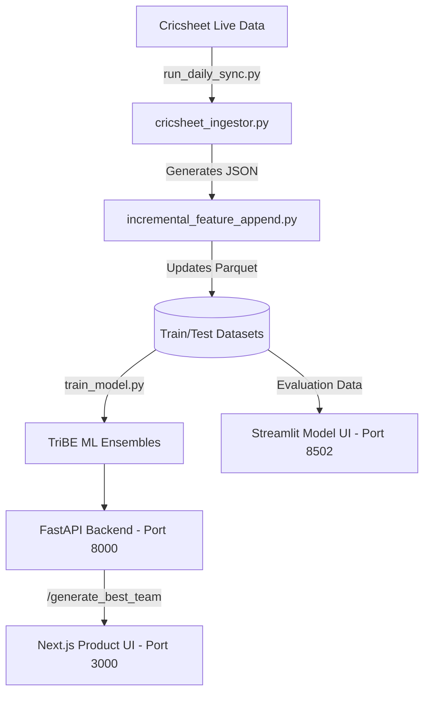

# NEW_X1 — Cricket Performance Intelligence Platform

> Predicts individual player performance and optimizes playing XI for upcoming cricket matches (T20, ODI, Test)  
> Expert analyst tool — not a fantasy sports app.

---

## 🚀 Quick Start

### 1. Prerequisites
- **Python 3.10 or 3.11**
- **Node.js 18+ and npm** (for the Next.js frontend)
- [Ollama](https://ollama.com) installed locally (for AI commentary)

### 2. Environment Setup

**Python Backend Setup:**
```bash
python -m venv env
env\Scripts\activate          # Windows
pip install -r requirements.txt

# Pull local LLM for AI generation
ollama pull llama3.2:3b
```

**Next.js Frontend Setup:**
```bash
cd frontend
npm install
cd ..
```

### 3. Generate Data (One-Time / Nightly Sync)
To dynamically pull the latest matches from Cricsheet (up to today) and run feature engineering:
```bash
python run_daily_sync.py
```
*Note: This downloads `all_json.zip` directly from Cricsheet, generates the player fantasy points database, and incrementally updates the Parquet features.*

### 4. Train Models
```bash
python model/train_model.py
# Creates: model_artifacts/ProductUI_Model  (T20 CatBoost)
#          model_artifacts/tribe_odi.pkl
#          model_artifacts/tribe_test.pkl
```

### 5. Run Platform (Universal Launcher)
You no longer need to open multiple terminals. Simply run the universal script:
```bash
run_all.bat
```
This automatically boots:
1. **Next.js Product UI** (`http://localhost:3000`)
2. **FastAPI Backend** (`http://localhost:8000`)
3. **Model Evaluation Streamlit** (`http://localhost:8502`)

Press `Ctrl+C` in the terminal to gracefully shut down all services.

---

## 🏗️ Architecture



## 🔌 Port Map

| Service | Technology | Port | Purpose |
|---|---|---|---|
| **Product UI** | Next.js / React | `3000` | End-user custom simulator and upcoming fixtures. |
| **Main API** | FastAPI / Python | `8000` | ML Predictions, Optimization Solver, LLM calls. |
| **Model UI** | Streamlit | `8502` | Internal MAE benchmark evaluation dashboard. |
| **Ollama** | Local LLM Engine | `11434` | RAG/Context-aware explanations. |

---

## 🧠 Intelligence Engine

| Format | Core Model | Artifact Path |
|---|---|---|
| **T20** | CatBoostRegressor | `model_artifacts/ProductUI_Model` |
| **ODI** | TriBE Ensemble | `model_artifacts/tribe_odi.pkl` |
| **Test** | TriBE Ensemble | `model_artifacts/tribe_test.pkl` |

**TriBE Architecture**: A meta-learning ensemble combining CatBoost, XGBoost, and LightGBM outputs fed into a LinearRegression meta-model (OOF stacking) for highly stable long-tail predictions.

---

## 📊 Data Pipeline

- **Source**: [cricsheet.org](https://cricsheet.org) — ball-by-ball JSON
- **Training window**: `2010-01-01` to `2025-06-30` (Strict cap to prevent leakage)
- **Testing window**: `2025-07-01` to `Today` (Rolling dynamic cutoff via `run_daily_sync.py`)
- **Future window**: `Today + 1` to `T+7 days` (Upcoming fixtures inference)

## 🔌 API Reference (FastAPI, port 8000)

| Endpoint | Method | Purpose |
|---|---|---|
| `/health` | GET | Model availability per format + Ollama reachability. |
| `/matches` | GET | Upcoming fixtures feed. |
| `/match_squads?match_id=` | GET | Normalized, name-resolved squads with roles & injury status. |
| `/teams` | GET | Known team names + venues (Custom Simulator datalists). |
| `/generate_best_team` | POST | Full pipeline: squad → name resolution → TriBE predictions → pitch/weather/injury adjustments → PuLP optimal XI. Accepts `match_id` or `team1+team2+format+venue+date`. |
| `/explain_team` | POST | SHAP top-3 drivers per selected player + local-LLM analyst report (heuristic fallback when Ollama is offline). Body: `{"explain_token": "..."}` from the generation response. |

Optional generation flags: `use_ml` (TriBE vs recent-form statistics), `use_intelligence` (weather/pitch/injury layer), `risk_aversion` (λ in `Σμ − λ·σ²`, 0.0–0.2), `scan_news` (Google News RSS injury scan, slow).

## 🧩 Product Modules

- **Name resolver** (`model/name_resolver.py`): bridges Cricbuzz display names and Cricsheet keys. Gender-filtered, ambiguity is refused rather than guessed — a wrong match silently corrupts predictions.
- **Team generator** (`model/team_generator.py`): orchestrates prediction, league priors for players without history, PAF pitch multipliers, injury multipliers, PSD covariance, and the PuLP solver with a constraint-relaxation fallback ladder.
- **Intelligence layer** (`intelligence/`): Open-Meteo weather with venue geocoding + 30-min cache, curated pitch profiles (PAF), injury status engine, SHAP driver extraction, Ollama analyst.

## ⚖️ Hard Rules

1. Training data strictly `≤ 2025-06-30` (No future data leakage).
2. `model_artifacts/ProductUI_Model` must exactly match this path and have no file extension.
3. Next.js UI response `≤ 10 seconds` for optimal user experience (models & datasets are process-cached; first call per format is slower).
4. MAE CSV generated by the Model Evaluation UI must be 100% reproducible with the exact same inputs.
5. Fixture/squad feeds: the full 7-day window needs `RAPID_API_KEY` (Cricbuzz via RapidAPI) in `.env` — run `data/future_matches/schedule_fetcher.py` + `squad_fetcher.py`. Without it, `run_daily_sync.py` auto-refreshes *imminent* fixtures via the free cricketdata.org key (`cricapi_sync.py`), and the UI degrades to retrospective analysis of the last known feed.
