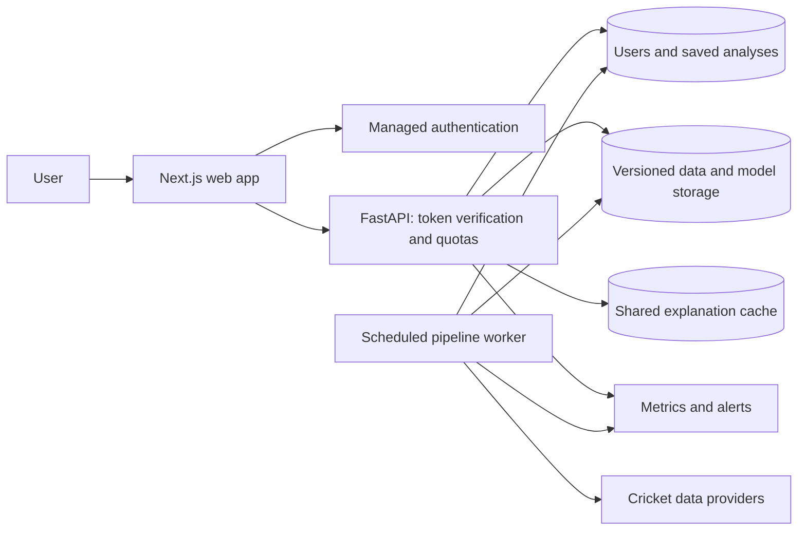

**NEW_X1 — independent recheck and next-version plan, 7 October 2026**

**Verdict: the core local application works, but the project is not ready for an unrestricted public production launch.** Passing tests support the existing implementation; additional failure probes exposed defects outside that coverage. Google/email/phone authentication and a deployed, monitored pipeline remain future work.

Reviewed commit: `974bb823058003e64de834d06a81ab16c66f11c0`, plus two existing untracked files: `model/api_schemas.py` and `tests/test_explanation_faithfulness.py`. This audit does not implement authentication, repair application code, provision hosting, or publish a release. Evaluation was rerun and produced unchanged tracked results. This report is the audit deliverable.

**Fresh verification**

| Check | Result | Practical limit |
|---|---|---|
| Python unittest discovery | 64 passed in 32.356 seconds | Includes six tests from an untracked file; the committed suite contains 58 |
| Frontend lint | Passed | Does not exercise browser interactions |
| Frontend production build | Passed | A successful build does not verify a remote API or deployed data storage |
| Python dependency consistency (`pip check`) | No broken requirements | Existing environment; not a clean Linux deployment install |
| T20, ODI, Test evaluation | All beat recent-form baseline | Prediction intervals miss their coverage target |
| Live local generation, one fixture per format | All three passed strict XI validation | Sequential smoke checks; intelligence was disabled; not a concurrency benchmark |
| Live `/health` | `ok`, all three models loaded; Ollama unavailable | Some large data sources were reported as `unchecked` |
| Live fixture availability | 31 fixtures, 24 with usable squads | Homepage disagreed with API on seven availability flags |
| Additional failure probes | Four correctness/recovery defects reproduced | These are not caught by the passing suite |

Live generation took 3.60 seconds for T20 fixture 151576, 6.23 seconds for ODI 169910, and 1.92 seconds for Test 172671. These are individual local observations, not service-level latency guarantees. All returned `validation.valid=true` and `constraint_mode=strict`.

Commands rerun: `env/Scripts/python.exe -m unittest discover -s tests -p 'test_*.py' -v`; frontend `npm run lint` and `npm run build`; `env/Scripts/python.exe -m model.evaluate t20 odi test`; `env/Scripts/python.exe -m pip check`. Additional probes used temporary files and synthetic data, leaving actual models and feeds intact.

| Format | Holdout matches | Model MAE | Baseline MAE | MAE improvement | Interval coverage / target |
|---|---:|---:|---:|---:|---:|
| T20 | 1,358 | 23.76 | 27.36 | 13.2% | 73.1% / 80% |
| ODI | 200 | 30.81 | 34.63 | 11.0% | 71.7% / 80% |
| Test | 44 | 47.83 | 57.48 | 16.8% | 72.9% / 80% |

Selection regret also improved: T20 157.59 versus 174.54, ODI 226.19 versus 256.10, Test 357.30 versus 425.50. Test-format evidence is based on substantially fewer matches. These measurements concern the evaluated model path and do not establish the benefit of every weather, pitch, injury, or captaincy heuristic. Saved evidence: [evaluation summary](<D:/Personal Coding/Data Science and ML/NEW_X1/outputs/eval_summary.json>).

**Findings to resolve before launch**

Priority here means urgency for public release: P1 blocks release; P2 is a correctness or reliability defect to resolve before the beta exit gate.

| Priority | Finding and evidence | Required correction and acceptance |
|---|---|---|
| P1 | An incomplete TriBE bundle with valid schema metadata is accepted as current. A probe with a real healthy backup still failed prediction with `KeyError: base_model_names`. [Loader](<D:/Personal Coding/Data Science and ML/NEW_X1/model/predict_model.py:108>) | Validate learner names, fitted learners, meta-model, feature order and a prediction smoke check before accepting a bundle. Both incomplete and corrupt primaries must select the healthy backup. |
| P1 | Fixture `fetched_at: 123` raises `AttributeError`, bypassing the valid backup. [Timestamp validation](<D:/Personal Coding/Data Science and ML/NEW_X1/data/future_matches/fixture_store.py:21>) | Reject invalid types as controlled validation errors; test every metadata field, malformed entries, and both-copies-invalid behavior. |
| P1 | Homepage reads `../data/future_matches` from the frontend host. Backend refreshes will not update a separately hosted frontend's filesystem. Seven `has_squad` flags already disagree locally. [Homepage](<D:/Personal Coding/Data Science and ML/NEW_X1/frontend/src/app/page.tsx:38>) | Load fixtures through the backend contract. Verify refreshed squads appear without rebuilding the frontend. Configure production API URL and CORS explicitly. |
| P1 | Public API routes have no authentication, user ownership, generation quotas, or rate limits. Explanation tokens reside in one process. [API](<D:/Personal Coding/Data Science and ML/NEW_X1/model/model_fastapi.py:245>) | Verify auth tokens server-side, enforce ownership and request budgets, and persist/cache explanations across workers and restarts. |
| P1 | The full pipeline is not represented by a deployed scheduler. Daily script handles ingestion/features and an imminent-fixture refresh, while full-window fixtures/squads remain separate commands. [Runner](<D:/Personal Coding/Data Science and ML/NEW_X1/run_daily_sync.py:39>) | Deploy a scheduled worker with timeouts, retries, overlap protection, run records and freshness alerts. Persist data and models outside ephemeral app disks. |
| P2 | Exact player-name resolution ignores `require_gender`; a female-only synthetic record resolved for a male request. [Resolver](<D:/Personal Coding/Data Science and ML/NEW_X1/model/name_resolver.py:72>) | Apply gender checks to every path and use registry IDs to address broader name collisions. Test the actual resolved history, not just the display name. |
| P2 | Solver loop overwrites the request's `mode`. All three live requests sent `prediction` and returned `request.mode=strict`. [Loop](<D:/Personal Coding/Data Science and ML/NEW_X1/model/team_generator.py:779>) | Keep request mode and constraint mode in separate variables; assert response semantics for prediction, retrospective and each relaxation level. |
| P2 | Curated T20 venue numbers apply across formats. Wankhede returned average first innings 180 and batting factor 1.10 for T20, ODI and Test. UI displays this as an average. [Profiles](<D:/Personal Coding/Data Science and ML/NEW_X1/intelligence/pitch_analyzer.py:100>) | Compute format-specific statistics with sample size and cutoff, or explicitly mark a curated prior and omit unsupported statistical claims. |
| P2 | FIT and UNKNOWN availability can yield a displayed 100% playing probability for squad members, without confirmed XI evidence. [Adjustment](<D:/Personal Coding/Data Science and ML/NEW_X1/model/team_generator.py:730>) | Separate squad eligibility, confirmed selection and estimated probability. Calibrate any probability that remains in the product. |
| P2 | Prediction intervals cover only 71.7–73.1% of observations against an 80% target. | Calibrate on a separate chronological validation window, then measure on untouched holdout; report results by format and experience. |
| P2 | New API schemas are untracked and unused by the active API, which declares its own models. New explanation tests use a live fixture and fixed future date. One ensemble comparison passes whenever a nonzero impact exists. [New test](<D:/Personal Coding/Data Science and ML/NEW_X1/tests/test_explanation_faithfulness.py:109>) | Consolidate the active contract; make tests self-contained, freeze/mock dependencies, assert exact weighted attribution, and commit only after clean-checkout verification. Existing committed tests already cover weighted attribution with synthetic inputs. |

**Hardcoded data and backup verdict**

Reference constants such as scoring rules, venue coordinates and supported roles can remain code/configuration if versioned and documented. Curated pitch multipliers, injury weights, risk-aversion defaults and captaincy weights are assumptions; they need clear provenance and calibration before being described as measured intelligence. Future-date test fixtures should be isolated, controlled test data.

Local last-good files, neutral weather behavior, recent-form model fallback and heuristic explanations are useful recovery mechanisms already present. They are incomplete protection: the malformed timestamp and incomplete-model probes show failure cases that evade recovery, and copies on the same machine do not cover loss of that machine.

| Failure | Intended production behavior |
|---|---|
| Fixture or squad provider fails | Serve a validated snapshot with timestamp and visible stale status; disable generation where required player data is missing |
| Model fails validation or prediction | Use a verified compatible model release; otherwise use a clearly labelled recent-form baseline if its data is valid |
| Primary historical data is invalid | Load a compatible validated snapshot; if no valid history exists, return a clear unavailable response |
| Weather/news is unavailable | Report unknown/unavailable and use neutral adjustments; do not invent conditions or fitness |
| Ollama fails | Return the existing deterministic explanation path and identify its source |
| No legal XI exists | Return the violated constraints; use relaxation only with the user's explicit selection |
| SMS or email delivery fails | Offer another previously verified/linked login method; keep ownership verification intact |
| Host or disk is lost | Restore versioned remote data, model releases and database backups, then verify health and prediction |

Promote a complete data/model release with a manifest and checksums, retaining the previous compatible release. A fallback must retain honesty and validity; it cannot guarantee a successful prediction when essential evidence is unavailable.

**Milestone interpretation**

M1 leakage protections and M3 strict XI validation have useful passing evidence. M2 models beat their baselines, but uncertainty calibration remains open. M4 has ensemble attribution, typed requests and fallback explanations, with remaining provenance, hardcoded-statistic and test-quality gaps. M5 has pinned direct dependencies, local recovery, latency logging and a CI workflow, but production operations are incomplete. A milestone commit does not close every acceptance criterion.

The existing issue register also retains the 30 hand-verified scoring-innings target, scoring-version stamps and a full-dataset unchanged rerun. The current scoring file has 14 cases; fixed-data idempotency tests are not proof for the whole production dataset. Hosted CI success, clean Linux installation, full-pipeline provider integration, browser end-to-end tests, concurrent load and remote restore were not verified in this audit. GitHub CLI was unavailable. No full production security assessment was performed.

**Login options for the next version**

Treat the requested login methods as separate product choices:

- Google sign-in: a Google identity login button. [Supabase Google integration](https://supabase.com/docs/guides/auth/social-login/auth-google).
- Email OTP: a code sent to Gmail or another email provider. [Email OTP support](https://supabase.com/docs/guides/auth/auth-email-passwordless).
- Google Authenticator, if that is what “GAuth” means: TOTP as an additional factor after login, including administrator enforcement. [MFA support](https://supabase.com/docs/guides/auth/auth-mfa).
- Mobile OTP: a code sent through an SMS provider. Supabase supports provider integrations including Twilio, Vonage and MessageBird. [Phone authentication](https://supabase.com/docs/guides/auth/phone-login).

| Option | Project fit | Tradeoff |
|---|---|---|
| Supabase Auth + Postgres — recommended starting point | Google, email OTP, optional SMS OTP, TOTP; relational storage for users, saved teams and pipeline runs | Configure external production SMTP and SMS delivery; implement ownership policies and backend verification |
| Firebase Authentication | Alternative if the roadmap centers on mobile apps and Google's ecosystem; Google and phone authentication are documented | Web phone login requires reCAPTCHA; user data storage and FastAPI authorization still need an explicit design |
| Self-hosted identity/OTP service | Consider only when infrastructure ownership is a firm requirement | Highest responsibility for delivery, abuse controls, recovery, uptime and upgrades; defer for the first beta |

Firebase references: [Google sign-in](https://firebase.google.com/docs/auth/web/google-signin), [phone sign-in](https://firebase.google.com/docs/auth/web/phone-auth). Supabase's default SMTP is explicitly not intended for production; configure a production sender before public email OTP. [SMTP requirements](https://supabase.com/docs/guides/auth/auth-smtp).

Start with Google plus email OTP, make phone optional, and require TOTP for administration. Link methods only after verified ownership so users keep one account. Include logout/session expiry, recovery, account deletion and per-user access checks. Test expired/wrong/reused OTPs, resend throttling, delivery failures, token expiry and attempts to access another user's saved team. Country support and SMS cost must be checked against the actual launch audience; no fixed monthly cost is assumed here.

**Deployment options**

The recommendation assumes a small public beta; budget, country and traffic remain unconfirmed.

| Option | Layout | Choose when |
|---|---|---|
| Managed split services — recommended | Next.js on Vercel or Render; FastAPI container and worker on Render; managed Postgres/auth; versioned object storage; shared cache when using multiple workers | You want simpler operations and independent web/API/pipeline releases |
| Single VPS with containers | Reverse proxy, Next.js, API and scheduled worker on one VM; managed auth; off-machine backups | You accept patching, monitoring and a single-host failure domain in exchange for direct control |
| Larger cloud platform | Container services, managed database/cache/object storage, scheduled jobs and staged deployments | Traffic, uptime requirements or an operations team justify additional complexity |

Architecture choice is engineering judgment based on this repository. Keep ML inference and ingestion in a service/worker sized from measured memory and concurrency. Vercel Functions have deployment, memory and duration limits, so assess that separately from hosting the Next.js UI. [Vercel limits](https://vercel.com/docs/functions/limitations).

Render cron jobs cannot access persistent disks. Render service disks are private to one instance and restrict scaling and zero-downtime deployment. Therefore a worker and API should exchange durable artifacts through object storage or a database, rather than assume a shared local folder. [Cron constraints](https://render.com/docs/cronjobs), [disk constraints](https://render.com/docs/disks).

**Recommended execution order and release gates**

| Stage | Work | Completion evidence |
|---|---|---|
| 1. Correctness and recovery | Fix reproduced defects; unify fixture/API contract; remove misleading pitch/probability labels; reconcile untracked work | Regression probes pass; clean-checkout CI passes; UI and API availability agree |
| 2. Accounts and persistence | Google/email login, optional phone, admin MFA; user-owned saved analyses; shared explanation state | Auth and ownership tests pass; sessions and analyses survive restarts |
| 3. Reproducible staging | Linux container builds; public API configuration; durable artifact bootstrap; automated data/squad jobs | A fresh staging environment serves all formats without copying files manually from this laptop |
| 4. Operational verification | Provider timeouts, failed pipeline runs, rollback, backup restore, concurrent-load tests and metrics | Measured latency/error/memory limits; old release remains usable during failed refresh; restored service passes smoke tests |
| 5. Public beta | Custom domain/HTTPS, bounded usage, visible freshness and uncertainty, support/error reporting | Browser journey passes from login through saved XI/explanation; alerts fire in injected failures; every remaining limitation is visible |
| 6. Product expansion | Features below, informed by usage and forecast quality | Each feature has a measurable quality or usability acceptance criterion |

Specify uptime, peak users, acceptable prediction latency and recovery time before choosing the production instance sizes. A practical first drill target could be restoration within one hour with at most one daily snapshot lost; user account data may need a tighter target. These are proposed targets, not current guarantees. No deployment can promise zero issues; release evidence should prove detection, controlled degradation and recovery.

**Future features with the highest value**

1. Saved teams, prediction history and explainable comparisons: store model version, data cutoff and source status with every result.
2. Confirmed-XI and toss updates: distinguish provisional squads from confirmed players, then regenerate with a visible before/after change list.
3. Player lock/exclude and alternative valid teams: show exactly which user choices make a team infeasible.
4. Trustworthy uncertainty: calibrated ranges, unknown-player indicators and format-specific backtesting rather than an unsupported accuracy percentage.
5. Data-quality dashboard: last successful sync, upcoming missing squads, unresolved identities, fallback use and failed jobs with controlled retry.
6. Model release registry and performance monitoring: compare a proposed model with the current model, promote only after evaluation, and support rollback.
7. Mobile-friendly/PWA experience and opt-in match reminders, after account linking and reliable fixtures are established.

Defer payments, premium tiers, a native mobile app and additional model complexity until the beta meets its correctness and reliability gates. The next useful version is one users can sign into, understand, revisit and trust when a provider is temporarily unavailable.
